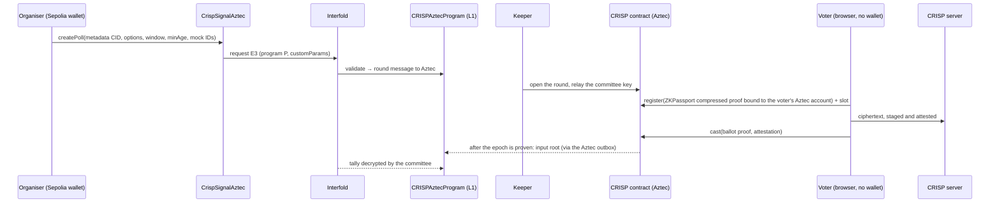

# CRISP Signal

A demo signalling app for institutions on the running Sepolia and Aztec testnets. Organisers create
polls on Ethereum; voters prove eligibility with [ZKPassport](https://zkpassport.id) (one passport or
national ID card, one vote) and cast secret ballots on Aztec through
[CRISP](https://github.com/theinterfold/CRISP) on the Interfold. Only the final tally is ever
decrypted. Results are signals: nothing is executed on-chain.

```
contracts/   Foundry: CrispSignalAztec, the poll board on Sepolia
app/         Vite + React front end; vendor/ holds the CRISP SDK tarballs
```

## How it fits together



- **Poll board** (`CrispSignalAztec`, Sepolia) requests the poll's E3 from the Interfold with the
  Aztec CRISP program, passing `abi.encode(numOptions, 1, minAge, allowMockDocuments)`. It is the E3
  requester, so it pulls the Interfold fee from the creator and forwards any refund of a failed
  round (`claimRefund`). The metadata CID and a poll list live in the board.
- **Registration** happens on Aztec. The browser makes an Aztec account (kept in `localStorage`),
  asks the ZKPassport app for a `compressed` proof for the domain `poll.theinterfold.com`, with the
  round's scope (the program's `scopeOf(e3Id)`), the age floor, and the Aztec account bound into the
  proof, then proves and sends `register` / `register_with_age` in the browser. Fees are paid by
  Aztec's SponsoredFPC, so voters need no wallet and no gas. Each document registers once per poll.
  The registered slot is an EVM key made for this poll and kept in `localStorage`, so the account and
  the slot are not linked on chain.
- **Metadata** (title, organisation, description, option labels) is pinned to IPFS by the app's
  `/api/pin` function (`app/api/pin.ts`), which holds the Pinata key server-side and pins only
  well-formed poll documents; the board stores the CID.
- **Voting** uses `@crisp-e3/sdk`: the committee key comes from the CRISP server and is checked
  against the key commitment on Aztec, the ballot is proved in the browser (noir-recursive fold
  proof), staged with the CRISP server, which attests availability, and cast on Aztec. Voters can
  recast; the latest ballot counts. The app keeps each ciphertext it cast, because the server only
  indexes a ballot once Aztec has proven its epoch and a revote has to build on the latest one.
- **Masks**: anyone can add an unsigned all-zero ballot to a uniformly random registered slot, or to
  their own. The circuit adds it to the slot's current ciphertext, so no choice changes, but on Aztec
  it is indistinguishable from a vote or a re-vote, which makes vote receipts unreliable.
- **Results** are 1-2 hours slower than on Ethereum alone: after voting closes, the round's input root
  reaches Ethereum only once Aztec has proven the epoch (the program waits at least its
  `remoteFinalityWindow`, 3 hours on the current deployment, inside the Interfold's compute window);
  then the tally is computed and decrypted. The app reads the tally from the program's `decodeTally`
  and a poll's status from Ethereum plus Aztec's public logs.

## Contracts

```sh
cd contracts
forge build
forge test                                                  # unit tests
SEPOLIA_RPC_URL=https://ethereum-sepolia.publicnode.com \
CRISP_AZTEC_PROGRAM=0x... forge test                        # + Sepolia fork test
```

The fork test creates a real poll through the board on a Sepolia fork and checks the E3 it requests.

Deploy (needs a funded Sepolia key and the Aztec CRISP program from crisp-aztec's Sepolia deployment):

```sh
CRISP_AZTEC_PROGRAM=0x... \
forge script script/Deploy.s.sol --rpc-url sepolia --broadcast --skip-simulation --private-key $PRIVATE_KEY
```

`--skip-simulation` is required: Sepolia now prices contract creation far above what forge's local
simulation charges, so a simulated gas limit runs out. With the flag, forge uses the node's
`eth_estimateGas`. The constructor checks the program is bound to the same Interfold as the board.

After changing the contracts, regenerate the app's ABI from `contracts/out` into
`app/src/lib/contracts.generated.ts`.

## App

```sh
cd app
npm install             # the CRISP SDKs are tarballs in vendor/
cp .env.example .env    # set VITE_BOARD_ADDRESS and PINATA_JWT
npm run dev             # http://localhost:5180
npm run build
```

`vendor/crisp-e3-sdk-0.28.1.tgz` is `@crisp-e3/sdk` from crisp-aztec with the `noir-recursive` fold
target; `vendor/crisp-e3-aztec-0.28.1.tgz` is `@crisp-e3/aztec` with the CRISP Aztec contract's
artifact. Rebuild them with `pnpm pack` in `packages/crisp-sdk` and `extensions/aztec/sdk` of
crisp-aztec. `package.json` overrides `@crisp-e3/sdk` so the Aztec SDK uses the vendored one.

| Variable | Purpose |
|---|---|
| `VITE_BOARD_ADDRESS` | Deployed `CrispSignalAztec` (required) |
| `VITE_SEPOLIA_RPC_URL` | Ethereum reads |
| `VITE_CRISP_SERVER_URL` | Hosted CRISP server in Aztec mode (`https://private-crisp.theinterfold.com/aztec`) |
| `VITE_AZTEC_NODE_URL` | Aztec testnet node (default `https://aztec-testnet.drpc.org`) |
| `VITE_ZKPASSPORT_DOMAIN` | ZKPassport domain of the Aztec contract (default `poll.theinterfold.com`) |
| `VITE_IPFS_GATEWAY` | Reads poll metadata |
| `PINATA_JWT` | Server only: `/api/pin` uses it to pin poll metadata. Never bundled |
| `VITE_WALLETCONNECT_PROJECT_ID` | Optional: adds WalletConnect to the wallet modal (poll creators only) |

The Aztec contract's address is read from the board (`CRISP_PROGRAM().l2Program()`), and the CRISP
server's config is checked against it.

`npm run dev` serves `/api/pin` through a Vite middleware, the same handler Vercel runs in
production. Hosting must send `Cross-Origin-Opener-Policy: same-origin` and
`Cross-Origin-Embedder-Policy: require-corp` (the browser prover needs `SharedArrayBuffer`); the dev
and preview servers already do, and `app/vercel.json` sets them on Vercel along with the SPA
rewrite. Everything the page fetches must allow it (CORS), including the Aztec node and the CRISP
server.

Creating a poll costs the Interfold fee in Sepolia MockUSDC (about 22 USDC for a one-day poll with
the Minimum committee); the create page links the testnet faucet. A poll's voting window must open
after the committee's key setup (about 40 minutes) and last at least an hour.

Registering or voting is real in-browser proving (Aztec private kernel proofs, then the ballot's fold
proof): expect a minute or more per transaction, and keep the tab open.

## ## Limits

- Eligibility is per document: a person with two qualifying documents can register twice.
- Verification trusts ZKPassport's circuits and its certificate registry on Aztec, which ZKPassport
  administers. The contract verifies one circuits release (see `circuitsVersion` in the deployment).
- Polls that accept mock IDs (dev mode) are open to anyone.
- The Aztec account and the slot keys live in the browser's `localStorage`: clearing it forfeits a
  registration. The poll page offers a backup download.
- Masks are opt-in: they protect only as far as voters actually submit them.
- The Sepolia CRISP deployment uses a mock compute verifier and mock data availability.

## Current Sepolia deployment

| App | `CrispSignalAztec` | Aztec CRISP contract |
|---|---|---|
| https://poll.theinterfold.com | [`0xD904eF69a2916A4bF4D41f947a6b01Aa8eaf3fEC`](https://sepolia.etherscan.io/address/0xD904eF69a2916A4bF4D41f947a6b01Aa8eaf3fEC) | `0x0e9654a9cd7333f8e7066f37d27a836738b12e1f092ed7d06b4863a5ef08c965` (Aztec testnet) |

The board's CRISP program is [`0x9EDF975320C08f33995894c3D9F1a8086a95e36A`](https://sepolia.etherscan.io/address/0x9EDF975320C08f33995894c3D9F1a8086a95e36A).
