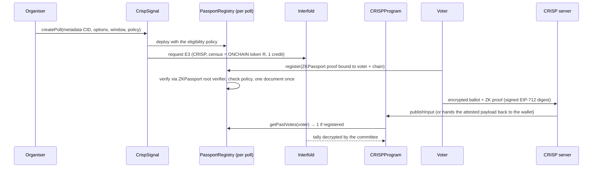

# CRISP Signal

A demo signalling app for institutions on the running Sepolia testnet. Organisers create polls; voters
prove eligibility with [ZKPassport](https://zkpassport.id) (one passport or national ID card, one
vote), and cast secret ballots through [CRISP](https://github.com/theinterfold/CRISP) on the
Interfold. Only the final tally is ever decrypted. Results are signals: nothing is executed on-chain.

```
contracts/   Foundry: CrispSignal (poll board) and PassportRegistry (per-poll census)
app/         Vite + React + wagmi front end
```

## How it fits together



- **Poll board** (`CrispSignal`) deploys a `PassportRegistry` per poll and requests the poll's E3
  with CRISP's `CensusMode.ONCHAIN`, the registry as the census token, `CreditMode.CONSTANT` and one
  credit. It is the E3 requester, so it pulls the Interfold fee from the creator and forwards any
  refund of a failed round (`claimRefund`).
- **Census** (`PassportRegistry`) verifies a ZKPassport `compressed-evm` proof against the
  ZKPassport root verifier under the poll's own service config: domain from the board, scope
  `crisp-signal-<registry address>`, 7-day validity, dev mode per policy. It requires a non-salted
  unique identifier, the proof to be bound to `msg.sender` and this chain, the age floor, the exact
  nationality allow/deny list and strict FaceMatch when configured. Each document identifier
  registers one account per poll; `getPastVotes` returns 1 for registered accounts.
- **Metadata** (title, organisation, description, option labels) is pinned to IPFS by the app's
  `/api/pin` function (`app/api/pin.ts`), which holds the Pinata key server-side and pins only
  well-formed poll documents; the board stores the CID.
- **Voting** uses `@crisp-e3/sdk`: the committee key comes from the CRISP server and is checked
  against the E3's on-chain commitment, the ballot is proved in the browser and staged with the
  hosted CRISP server, which attests availability and commits it. Voters can recast; the latest
  ballot counts.
- **Masks**: anyone connected can add an unsigned all-zero ballot to a uniformly random verified
  voter's slot, or to their own. The circuit adds it to the slot's current ciphertext, so no choice
  changes, but on-chain it is indistinguishable from a vote or a re-vote, which makes vote receipts
  unreliable.

## Contracts

```sh
cd contracts
forge build
forge test                                                  # unit tests
SEPOLIA_RPC_URL=https://ethereum-sepolia.publicnode.com forge test   # + Sepolia fork tests
```

The fork tests create a real CRISP round on a Sepolia fork and check the E3 it requests.

Deploy (needs a funded Sepolia key):

```sh
ZKPASSPORT_DOMAIN=signal.example.org \
forge script script/Deploy.s.sol --rpc-url sepolia --broadcast --skip-simulation --private-key $PRIVATE_KEY
```

`--skip-simulation` is required: Sepolia now prices contract creation far above what forge's local
simulation charges (the board deployment takes about 21.5M gas, `createPoll` about 19.6M because
it deploys the poll's registry), so a simulated gas limit runs out. With the flag, forge uses the
node's `eth_estimateGas`.

`ZKPASSPORT_DOMAIN` must be the host name the app is served from: ZKPassport shows it to voters and
derives identifiers from it, and the board cannot change it later. Use `localhost` for local
testing.

After changing the contracts, regenerate the app's ABIs from `contracts/out` into
`app/src/lib/contracts.generated.ts`.

## App

```sh
cd app
npm install
cp .env.example .env    # set VITE_BOARD_ADDRESS and PINATA_JWT
npm run dev             # http://localhost:5180
npm run build
```

| Variable | Purpose |
|---|---|
| `VITE_BOARD_ADDRESS` | Deployed `CrispSignal` (required) |
| `VITE_SEPOLIA_RPC_URL` | Chain reads and the CRISP SDK |
| `VITE_CRISP_SERVER_URL` | Hosted CRISP server (`https://private-crisp.theinterfold.com`) |
| `VITE_IPFS_GATEWAY` | Reads poll metadata |
| `PINATA_JWT` | Server only: `/api/pin` uses it to pin poll metadata. Never bundled |
| `VITE_WALLETCONNECT_PROJECT_ID` | Optional: adds WalletConnect (mobile wallets by QR) to the wallet modal |

`npm run dev` serves `/api/pin` through a Vite middleware, the same handler Vercel runs in
production. Hosting must send `Cross-Origin-Opener-Policy: same-origin` and
`Cross-Origin-Embedder-Policy: require-corp` (the browser prover needs `SharedArrayBuffer`); the dev
and preview servers already do, and `app/vercel.json` sets them on Vercel along with the SPA
rewrite.

Creating a poll costs the Interfold fee in Sepolia MockUSDC (about 20 USDC for a one-day poll with
the Minimum committee); the create page links the testnet faucet.

## Limits

- Eligibility is per document: a person with two qualifying documents can register two wallets.
- Verification trusts ZKPassport's root verifier and registries, which ZKPassport administers.
- Polls that accept mock IDs (dev mode) are open to anyone. Mock IDs have nationality `ZKR`; an
  allow-list must include it for mock IDs to pass.
- ZKPassport commits ISO alpha-3 codes; Germany is `DEU` (the MRZ form `D<<` is not supported).
- Masks are opt-in: they protect only as far as voters actually submit them.
- The Sepolia CRISP deployment uses a mock compute verifier and mock data availability.

## Current Sepolia deployments

A board's ZKPassport domain is fixed, so each host has its own board. Vercel production
(`poll.theinterfold.com`) builds with `VITE_BOARD_ADDRESS` set to the first row.

| App | `CrispSignal` | ZKPassport domain |
|---|---|---|
| https://poll.theinterfold.com | [`0xA9802BE13C6810b90fc11726ec8fC85BE128AA80`](https://sepolia.etherscan.io/address/0xA9802BE13C6810b90fc11726ec8fC85BE128AA80) | `poll.theinterfold.com` |
| http://localhost:5180 | [`0x9bfb40e434E2af0A203969b5dd02764FCe9f9153`](https://sepolia.etherscan.io/address/0x9bfb40e434E2af0A203969b5dd02764FCe9f9153) | `localhost` |

Each board's poll #0 is a demo: mock IDs accepted, age 18+, any nationality.
